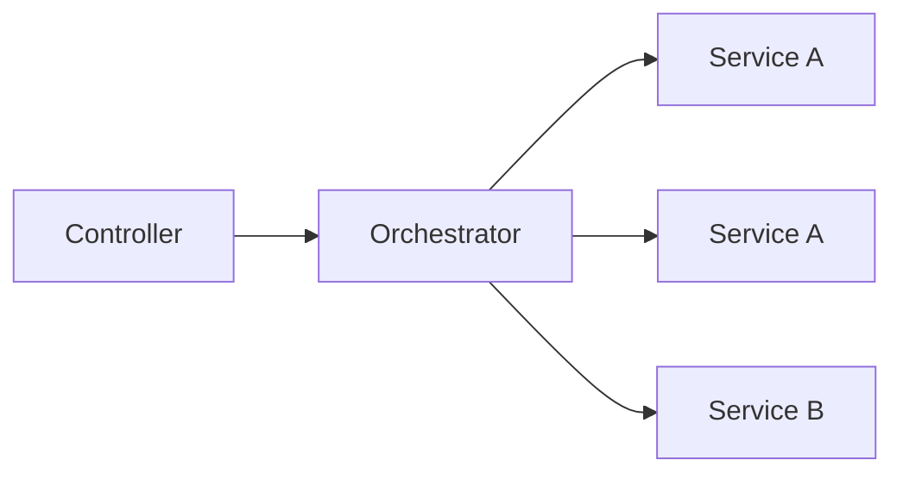

# {{ product_name }} Orchestrator

The {{ product_name }} Orchestrator manages scalable services in an {{ product_name }} deployment, it is somewhat like
a stateful load balancer. It proxies the internal web and signaling APIs of orchestrated services and forwards requests
to the appropriate service instance.

The following services can be scaled when configured with the orchestrator:

| Service                           | Orchestrator endpoint |
| --------------------------------- | --------------------- |
| {{ product_name }} Roomserver     | `/roomserver/`        |
| {{ product_name }} Recorder       | `/recording/`         |
| {{ product_name }} Transcription  | `/transcription/`     |

## LiveKit quirks

LiveKit is a special case, it is not scaled through the orchestrator, but its signaling must still be proxied by the
orchestrator when scaling the roomserver.

LiveKit's signaling endpoint (`/rtc`) is already proxied by the roomserver. Running multiple roomservers would result in
multiple LiveKit signaling endpoints that need to be reachable by clients, one for each roomserver. To avoid this, the
orchestrator provides a LiveKit proxy under `/livekit/` that forwards LiveKit signaling requests to the correct
roomserver instance.

!!! important

  The LiveKit endpoint `<orchestrator-url>/livekit/` must be accessible by clients

## How it works

First, there must be an orchestrator running in the deployment.

To proxy a service with the orchestrator, the proxied service needs to have an `orchestrator` section configured. This
ensures that the services registers at the orchestrator on startup. Once registered, the service is part of the service
cluster. Requests to that service kind are routed through the orchestrator and forwarded to a single instance of that
service kind. The orchestrator keeps track of associated resources and ensures that requests to `room A` always get
forwarded to the instance that manages `room A`.



Not all services need to be scaled at once. A deployment could have a single 'standalone' `roomserver` instance but
multiple `recorder` instances that are scaled through the orchestrator.

## Configuration

The controller does not have a dedicated orchestrator settings section. Instead, the URLs of proxied services must be
replaced with the URL of the orchestrator, the URL needs to contain the service path from the table above.

There are three steps required to scale a service with the orchestrator:

1. Add the `orchestrator` section to the configuration of the proxied service
   (see [Service configuration](#service-configuration)).
2. In the `controller.toml`, replace the `url` and `api_key` of the proxied service with the orchestrator's proxy URL
   and API key.
3. In the `orchestrator.toml`, add the API keys of each proxied service to the `services.keys` configuration.

Refer to the sections below for specific service configurations.

### Roomserver

!!! warning

  When proxying the roomserver, the LiveKit signaling  **MUST** also be proxied by the orchestrator
  (see [LiveKit](#livekit)).

The roomserver `kind` has to be set to `external`. Replace the roomserver URL and API key with the orchestrator's URL
and key:

`controller.toml:`

```toml
# The orchestrator cannot proxy an internal roomserver
kind = "external"

# This is the orchestrator's URL that proxies the roomserver, mind the trailing slash
service_url = "http://localhost:11222/roomserver/"

# The orchestrator's API key
api_key = { id = "orchestrator", secret = "secret" }

...
```

Update the roomserver's config to include the `orchestrator` configuration
(see [Service configuration](#service-configuration)).

### LiveKit

!!! warning

  This **MUST** be configured when proxying the roomserver.

Replace the `public_url` in the `roomserver.modules.livekit` section with the orchestrator's LiveKit proxy URL. The
other values in that section can stay as they are, only the `public_url` needs to change:

`controller.toml:`

```toml
[roomserver.modules.livekit]
# LiveKit's API key
api_key = "devkey"
# LiveKit's API secret
api_secret = "secret"

# Use the orchestrator's proxy URL for LiveKit
public_url = "http://localhost:11222/livekit/"

# This is the URL of the actual LiveKit server
service_url = "http://localhost:7880"
...
```

### Recorder

Replace the recorder URL and API key with the orchestrator's URL and key:

`controller.toml:`

```toml
[roomserver.modules.recording]
# The orchestrator's proxy URL for the recorder, mind the trailing slash
url = "http://localhost:11222/recording/"
# The orchestrator's API key
api_key = { id = "orchestrator", secret = "secret" }
```

Update the recorder's config to include the `orchestrator` configuration
(see [Service configuration](#service-configuration)).

### Transcription

Replace the transcription URL and API key with the orchestrator's URL and key:

`controller.toml:`

```toml
[roomserver.modules.transcription]
# The orchestrator's proxy URL for the transcription service, mind the trailing slash
url = "http://localhost:11222/transcription/"
# The orchestrator's API key
api_key = { id = "orchestrator", secret = "secret" }
```

Update the transcription service's config to include the `orchestrator` configuration
(see [Service configuration](#service-configuration)).

## Service configuration

Each service that is proxied by the orchestrator needs to have its `orchestrator` section configured. This applies
to the `roomserver`, `recorder` and `transcription` services. The `orchestrator` section always has the following
format:

`<proxied-service>.toml:`

```toml
[orchestrator]
# The API key and secret of the orchestrator
api_key = { id = "orchestrator", secret = "secret" }
# The URL of the orchestrator
url = "http://localhost:11222"
```
